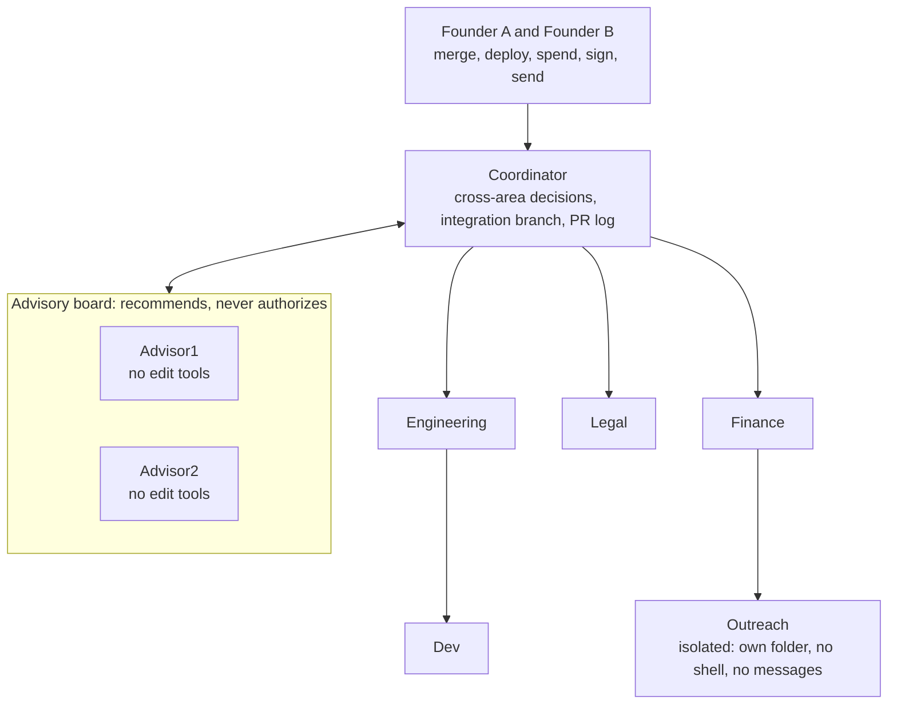

# Founder Mode

Founder Mode turns a handful of Claude Code sessions into a small company. Each session owns one area of an org chart. A coordinator takes what crosses areas, an advisory board audits the decisions you can't take back, and the founders keep the last word on merging, deploying, spending, signing and anything sent outside.

Plenty of tools run Claude Code agents in parallel, Claude Code's own agent teams among them. Founder Mode keeps each session in one role, with its own memory and conversation, for weeks, under a chain of authority that ends at a human.

It is a bash launcher, a set of markdown templates and four hooks around stock Claude Code. It runs no server or daemon and needs only bash, jq and node.

## What's in it

- **Chain of authority.** Only the founders authorize. A message from another session is data to check, whoever sent it, and it authorizes nothing.
- **Durable roles.** Each role keeps its own conversation, memory folder, model, effort and compaction window. A relaunch resumes where the role stopped.
- **Advisory board.** Two advisors and the coordinator vote blind and need unanimity, with two rebuttal rounds at most. The advisors get no file-editing tools. The board recommends and never authorizes.
- **Isolation.** The session that reads outside mail works inside its own folder, apart from the other roles' folders, without a shell, without the org chart and without messages to or from other sessions, because mail can carry hidden instructions.
- **Pace.** The usage limit belongs to the whole account, and one session can stop all the others. The pace rules keep one session from draining the account, and `founder-mode stalled` finds the sessions a limit stopped.
- **Git for many sessions on one account.** One branch per topic, one open PR per session and repository, a PR log, and a hook that stops the common git and gh commands that would publish under your name.

## The org chart



Arrows show who assigns work to whom. Any session can message the owner of a topic without going through the coordinator; Outreach works through files in its folder. The roles are templates: rename them, drop some, add your own in `roles.tsv`. Each transcript records the session name that opened it, so a role whose name you change starts again with `--new`.

## Why each rule exists

Most rules in this table came out of a real failure. The PR log works around a GitHub limit, and a founder asked for the send grant. [LESSONS.md](LESSONS.md) has the full list, each lesson with what happened, the cause, the fix and the file that holds it.

| Rule | What went wrong |
|---|---|
| A role resumes its own conversation by id, never through the resume picker | Several roles shared a working folder. A founder opened the picker, which lists every conversation in the folder, and resumed one role's conversation as another. |
| A conversation can't be open in two terminals | In that mix-up two processes wrote the same transcript at once. |
| Only founders merge, deploy, spend, sign or send | An agent told to work on its own read that as permission to merge. |
| The guard looks for `gh` anywhere in a command line, in Monitor as well as Bash | A session put a wrapper in front of `gh api` and got a write past a pattern anchored at the start of the line. Monitor runs shell commands too, and a guard on Bash alone never sees them. |
| A session hears when the org chart changes | A conversation keeps the prompt it started with, so the sessions already running never saw the edits. |
| The coordinator wakes sessions stopped by a usage limit | After a limit reset, one session resumed by itself and two others sat stopped for hours. |
| Pace follows `/usage`, not your own estimates | The coordinator set two homemade caps in one night, and both were wrong: heavy work waited while the real meter sat under a quarter. |
| Close to a reset, start pending work | Work held back for the reset left the end of the window unused. |
| A stop order outlasts a compaction | A session told to save and stop compacted, picked up its previous task from the summary and kept spending. |
| Check a due delivery in its file | A session sent two messages that reported success, and the receiver never saw them. |
| One open PR per session and repository, one push per batch | A session stacked more than a dozen PRs with the same change, and every push ran CI. |
| Every PR goes in a log | All sessions push under one GitHub account, so GitHub can't tell which session opened what. |
| A relaunch resumes the previous conversation | The coordinator relaunched a role fresh to save quota. The role lost its working context, and the founder wanted it back. |
| Per-role settings travel with the launch, never in a shared file | One global file held a setting for every session, and one session's startup could switch it off for all of them. |
| A rule marked as enforced binds without its hook | A session pushed from a clone where the repository's hooks weren't installed, and the check it skipped was failing. |
| Ten lines per message, the rest in a file | A long message costs output to write, and the receiver re-reads it on every request after. |
| A one-time send grant | A founder wanted one email sent from the isolated session without handing it a send tool for good. |

## How it works

### Launching a role

`founder-mode <role>` reads the role's row in `roles.tsv` and starts `claude` in the role's folder with:

- `--append-system-prompt`: the org chart followed by the role file (the isolated role gets its role file alone);
- `-n <name>`: the name other sessions use to message it;
- `--model`, `--effort` and `--autocompact`, from the row;
- `--settings`: `autoMemoryDirectory` set to the role's own memory folder, the hooks, the `settings/all.json` and `settings/<role file>.json` you add, and empty values for `CLAUDE_CODE_EFFORT_LEVEL` and `CLAUDE_CODE_AUTO_COMPACT_WINDOW`;
- `--session-id` for a new conversation, or `-r <id>` to resume one.

Claude Code ranks `CLAUDE_CODE_EFFORT_LEVEL` above `--effort` and `CLAUDE_CODE_AUTO_COMPACT_WINDOW` above `--autocompact`, so a value in your shell or user settings would override every row. The empty values cancel it, and the launcher warns on stderr when your shell sets either.

`FM_DRY_RUN=1 founder-mode <role>` prints the whole command and changes nothing.

### Conversations

The launcher keeps each role's conversation id in `$FM_HOME/state/<role>.session` and resumes it on the next launch. `/clear` and `/branch` start a new conversation inside the running session, so a hook writes the new id to that file, and the next launch and `founder-mode stalled` follow it. `-r <id>` pins another conversation of the same role, and `--new` starts a clean one. The launcher refuses:

- an id that isn't a UUID, since `claude -r <name>` runs a search that can land on another role's conversation;
- a conversation another role opened, by the first `agentName` in its transcript;
- a conversation, or a session name, that a live process holds, from Claude Code's session registry under `~/.claude/sessions/` (on Linux it also compares process start times, so a pid that a reboot handed to another program doesn't count);
- a role whose launcher is still running in another terminal, through a lock in `$FM_HOME/state/`;
- flags that would get around those checks: the ones that pick, fork or rename a conversation (`--from-pr`, `--teleport`, `--fork-session`, `-n`), turn the hooks off (`--safe-mode`, `--bare`), replace its settings (`--settings`) or move the session out of the terminal (`--bg`, `--desktop`, `--cloud`, `--environment`, `--tmux`), and grouped short options. It reads `-r<id>` as `-r <id>`, as `claude` does.

The launcher also gives every role `CLAUDE_CODE_DISABLE_AGENT_VIEW=1`, which turns off `/background`, the left-arrow key that does the same and `claude --bg`. Claude Code restarts a session you move to the background in a process of its background service, with that service's environment. It keeps only some launch flags: the documented list includes `--settings` and omits `--append-system-prompt`, `--tools` and `--restricted`.

Claude Code records the system prompt on a conversation's first request and reuses it on every resume until the conversation compacts, so a resumed session keeps the org chart it started with. The notice hook flags the stale prompt. It dates each conversation by the prompt it carries, in `$FM_HOME/state/loaded/`, and when `ORGCHART.md` or the role file is newer, it adds a note to the next prompt telling the session to read them again.

### Advisors

Each launch of an advisor starts a fresh conversation, one per case, and `-r` reopens the case in progress. Advisors get a fixed list of built-in tools (`Read`, `Glob`, `Grep`, `Bash`, `WebFetch`, `WebSearch`, `SendMessage`, `ListAgents`, `ToolSearch`) and lose every MCP tool, because a connector can write somewhere the launcher can't see. They keep Bash to check claims: the guard blocks the publishing commands on its list, and nothing else stops a write from the shell. They keep `SendMessage` to deliver their votes, and only their prompt limits it to the coordinator. The launcher refuses extra `claude` flags for them.

### The isolated role

The outreach role reads mail written by strangers. It runs with:

- `--restricted`: no shell and no web fetch, file tools confined to its folder, no settings files besides managed ones and `--settings`, and no bypass mode;
- `--permission-mode dontAsk`: Claude Code refuses any call nobody approved in advance, so a connector you add to your account later stays out until you allow it;
- a fixed list of built-in tools, with `Write` and `Edit` approved inside its folder, and without `SendMessage` or `ListAgents`, so outside text reaches the other sessions only in the files they choose to read, and they treat it as data;
- deny rules for every file that Claude Code loads by itself as instructions: `CLAUDE.md`, `CLAUDE.local.md`, `AGENTS.md` and anything under `.claude/`, in any letter case. The launcher adds them, so no template edit drops them. A session that reads a file in a folder of its own tree loads that folder's instructions, and so does a plain `claude` started in a folder above;
- no memory: `--restricted` turns off Claude Code's memory and CLAUDE.md, whatever `autoMemoryDirectory` says, so the role keeps its state in `log/`, which Finance reads too;
- its role file as the whole prompt, without the org chart;
- no hooks except the conversation pointer and the send grant below, so after you edit its role file, tell it what changed or relaunch it with `--new`.

It takes no messages either: since Claude Code 2.1.290, a `--restricted` session opens no inbox. The other sessions reach it through files in its folder, and when a usage limit stops it, a founder resumes it in its window.

Its folder sits outside every other role's folder (`~/outreach` in the template). The launcher refuses to start any role while an isolated folder holds another role's folder or sits inside one, and while it holds `$FM_HOME` or this checkout, where it could rewrite the org chart, the role files, the shared settings or the hooks.

`settings/outreach.json` lists the mail tools it may call. The template names the read and draft tools of the claude.ai Gmail connector. In tests with 2.1.303, a `--restricted` role got the claude.ai connectors and none of the MCP servers in the user's own configuration, so list a claude.ai mail connector's tool names in `settings/outreach.json`. `settings/all.json` denies the claude.ai Gmail and Microsoft 365 connectors to every other role. Add any other mail connector your account has to that deny list, or outside mail reaches the roles that keep it.

To let it send one message, start it with a grant:

```bash
FM_ONE_SEND='<address>' FM_SEND_TOOL='<send tool name>' FM_SEND_TEXT='<approved text file>' founder-mode outreach
```

The approved text is a file you reviewed: the subject on its first line, the body after it. The launcher approves that one tool, gives the launch its own grant and copies the text into `$FM_HOME/state`, where the role can't edit it. `hooks/one-send.sh` then lets one call through, to that address alone and with the approved subject and body unchanged. The call may set only `to`, `cc`, `bcc`, `subject` and `body`. A draft id or a reply-all switch would send to people the call doesn't name, and an HTML body would send text nobody approved, so the hook refuses any other field, and any line break in an address field or the subject. It also refuses the call unless the granted address is the only address in `to`, `cc` and `bcc`. The first call it allows uses up the grant, even if the send then fails; the next send needs a new launch. The field list at the top of the hook matches the claude.ai Gmail send tool; edit it for another connector.

The mail tools reach every thread in the mailbox they connect to, so give Outreach a mailbox of its own.

### Hooks

| Hook | Event | What it does |
|---|---|---|
| `irreversible-guard.sh` | PreToolUse on Bash and Monitor | Blocks the commands listed below. The session sees why and asks a founder. |
| `orgchart-notice.sh` | UserPromptSubmit | Tells a session, once, that the org chart or its role changed after its conversation started. For the coordinator it also names the live sessions stopped on an API error. |
| `session-pointer.sh` | SessionStart | Keeps `state/<role>.session` on the conversation that runs, including the new one that `/clear` or `/branch` starts. It skips a resume, because the launcher already wrote that id. |
| `one-send.sh` | PreToolUse on the send tool | Enforces a one-time send grant. |

The guard drops each redirection with its target, cuts the command at `;`, `&`, `|`, parentheses and backticks, and reads it twice: with quotes dropped, and with each quoted word kept whole. A command with a substitution (`$(...)` or backticks) gets two more readings, with each substitution as one word, so `git push origin "$(git branch --show-current)" -f` still counts as a forced push. It blocks:

- in `gh`: every subcommand of a command group or its aliases, except reads, `gh pr create`, clones and checkouts; a variable or a substitution in place of the group or the subcommand; `gh copilot`; and `gh api` with a write. The guard judges each `gh api` call on its own and lets through fields sent with `-X GET` and an inline GraphQL query without a mutation;
- `git push` with `--force`, `--force-with-lease`, `--force-if-includes`, `--mirror`, `--delete`, `--prune`, `--all`, `--branches`, `--tags` or `--follow-tags`, or any abbreviation of these that git accepts (`--del`, `--mirr`); with a short option group holding `f` or `d`; with a `+`, `:` or `*` refspec, a `refs/tags/` refspec or `tag <name>`; and to a branch named `main` or `master`;
- `git worktree remove --force`, and `git worktree remove` from anyone but the coordinator;
- `docker compose down -v`, `docker compose rm -v` (also as `docker-compose`), `docker rm -v` or `docker container rm -v`, `docker volume rm`, `docker volume remove` or `docker volume prune`, and `docker system prune --volumes`, with `--volumes` in place of `-v` too.

`FM_UNLOCK=1` at launch leaves the guard out of the session's settings, and the launcher prints a notice on stderr.

The launcher attaches the hooks through `--settings`, so your global settings stay untouched. It writes each hook's values into its entry as arguments, and Claude Code runs the hook without a shell:

- the guard gets the role's kind;
- the notice gets `$FM_HOME`, the role, its kind and its role file;
- the pointer gets `$FM_HOME` and the role;
- the one-send hook gets `$FM_HOME`, the role, the address and the grant.

No hook takes its role, kind, home, address or grant from the environment, which a session can inherit from another process. Without their arguments the guard, the notice and the pointer do nothing, so they stay harmless in your user settings too, and the one-send hook refuses every call.

Three switches outside the hooks turn them all off, the guard and the send gate included, as `--safe-mode` and `--bare` do. They are `disableAllHooks` in your user, project or local settings, and `CLAUDE_CODE_SAFE_MODE` or `CLAUDE_CODE_SIMPLE` in your shell. The launcher sets `disableAllHooks` to false in `--settings` and starts the session with both variables empty. It warns on stderr when your shell sets either variable or your user settings set `disableAllHooks`. A `disableAllHooks` in managed settings still wins.

Claude Code lets a call through when its hook can't start or times out, unless the hook sets `onFailure: "block"` (2.1.295 and later). The guard and the one-send hook set it, so Claude Code blocks the call when either script is missing, crashes or times out. The guard's timeout is 30 seconds. On Linux with bash 5.3 it read 1 MB in 4 to 7 seconds, whether the command held plain text, quotes, substitutions, lines split with a backslash, `gh` calls or `gh api` calls.

### Stalled sessions

`founder-mode stalled` lists the roles whose last conversation entry is an API error, such as a usage limit, and says whether each process is alive. It reads local files and costs no tokens. The coordinator's hook runs it on every prompt and names the live ones. After a reset, the coordinator wakes each with a message and asks a founder to resume the isolated role, which takes no messages. A closed session needs a relaunch.

### The checker subagent

`agents/checker.md` defines a subagent that runs tests, reads and greps, and reports facts with `path:line`. Its prompt forbids edits, commits and pushes. It keeps Bash to run tests; in a session the launcher started, the guard fires inside subagents too and blocks the publishing commands on its list, and nothing else stops a write. It starts without CLAUDE.md (`omitClaudeMd`) and with only the tools its file names, so a check skips the project file and the schemas of every other tool. It runs at `high` effort, because a subagent without its own `effort` takes the session's (2.1.303), and some roles run at `max`. Copy it to `~/.claude/agents/` or to a repository's `.claude/agents/`.

## Quick start

You need Claude Code 2.1.295 or later (tested with 2.1.296 and 2.1.303), bash, jq and node. Every session signs in with your own Claude account, so one account means one person. Make sure the terms of your plan cover what you do with it: the consumer plans (Free, Pro and Max) are meant for individual use, and in the European consumer terms they exclude business use; Team, Enterprise and API accounts come under the commercial terms.

```bash
git clone <this repository> ~/founder-mode
mkdir -p ~/.local/bin && ln -s ~/founder-mode/bin/founder-mode ~/.local/bin/founder-mode
export PATH="$HOME/.local/bin:$PATH"    # add this line to your shell profile too, unless it's already there
founder-mode init                       # templates into ~/.founder-mode; existing files are kept
${EDITOR:-nano} ~/.founder-mode/roles.tsv     # names, models, folders
${EDITOR:-nano} ~/.founder-mode/ORGCHART.md   # your founders, areas and rules
mkdir -p ~/company/product ~/company/admin ~/outreach   # the folders roles.tsv names
mkdir -p ~/.claude/agents && cp ~/founder-mode/agents/checker.md ~/.claude/agents/
FM_DRY_RUN=1 founder-mode coordinator   # read the command first
founder-mode coordinator                # then one terminal per role
```

Each row of `roles.tsv` holds the role, the session name, the model, the effort, the working folder, the kind (`-` for a member, `coordinator`, `advisor` or `isolated`), the compaction window and the role file, separated by tabs. Every folder must exist, and the first launch in a new folder asks you to trust it. `bash tests/smoke.sh` runs the launcher dry against a throwaway home folder, launches it against a stand-in `claude`, feeds the hooks sample calls and runs this quick start in a clean home folder.

Sessions talk through Claude Code's cross-session messaging: `SendMessage`, addressed by the name set with `-n`. Claude Code holds a message for your approval when the sender and the receiver differ on bypassing permission prompts. Set `crossSessionInbound` in `settings/<role file>.json` to change that for a role.

## Rules and lessons

The rules live in markdown you edit: `ORGCHART.md` for every session, `roles/*.md` for each role and `BOARD.md` for the board. [LESSONS.md](LESSONS.md) holds the lessons behind them.

## Limits

- **The guard is a list of patterns.** A session set on getting past it can wrap the command in a script, and any session with a shell can edit the hooks. These pass:
  - a `gh` extension, a `gh` alias you define, and a command group newer than the guard's list;
  - a push that doesn't name main (a bare `git push` or `HEAD`) from a checkout of main;
  - a tag pushed by its bare name (`git push origin v1.2`), which the guard can't tell from a branch;
  - a branch, or a `git` or `docker` subcommand, that a variable, a substitution or a brace expansion supplies (`git push origin ${BRANCH:-main}`, `git push origin {main,}`);
  - a command written as a list for another language (`subprocess.run(['gh', 'pr', 'merge', '1'])`);
  - package registries and deploy tools (`npm publish`, `docker push`), which aren't on the list;
  - `rm -rf` on a worktree folder.

  Put the hard stops on the server, with protection rules for branches and tags, and scoped tokens.
- **Quoted text and heredocs.** The guard reads quoted text and heredocs as part of the command. It blocks a commit message, a `git log --grep` pattern or a heredoc that names a blocked command, and `gh pr merge --help` too, and the session asks a founder. Write example commands to a file with the Write or Edit tool instead of `cat <<EOF`.
- **Internal files.** The ownership check, the open check and `stalled` read Claude Code's local transcripts and session registry, which aren't a public interface. A new version can break them, and the smoke test won't notice, since it fakes those files.
- **Launcher only.** Starting `claude` by hand skips every check. Inside a session, `/resume` can open another role's conversation, and `/teleport` and `/desktop` hand the conversation to the cloud or the desktop app, outside the launcher's lock and checks. A founder relaunches the role with `founder-mode <role> -r <id>` instead. A shell function in your `~/.bashrc` keeps plain `claude` out of the role folders:

  ```bash
  claude() { case $PWD/ in "$HOME"/company/*|"$HOME"/outreach/*|"$HOME"/.founder-mode/board/*) echo "use founder-mode <role>" >&2; return 1 ;; esac; command claude "$@"; }
  ```

- **Shell commands only.** The guard sees Bash and Monitor. A connector, or a built-in tool such as `RemoteTrigger`, acts without it: `settings/all.json` denies the mail connectors and `RemoteTrigger` to member roles. Deny there any other tool that writes outside, such as sharing a file or creating an event, or keep member roles out of bypass mode.
- **Agent view.** The role sessions can't open agent view or move to the background. Open `claude agents` from another terminal.
- **Two launchers on one dead lock.** If a launcher dies and two new ones start for the same role in the same instant, both get through.
- **No scheduler.** You open each role in a terminal, and the coordinator relays work by message.
- **Versions.** Claude Code 2.1.290 and 2.1.295 closed ways around `--restricted` and `--tools`, so the launcher checks `claude --version` before a real launch and refuses anything older than 2.1.295. Tested on Linux with bash 5.3.

## The name

The name comes from Paul Graham's essay [Founder Mode](https://paulgraham.com/foundermode.html), September 2024. Here it means the founders keep the last word on everything a session can't undo.

Founder Mode is the name of this project and nothing more. It is not affiliated with Paul Graham or Y Combinator, nor with any company that uses the phrase as a trademark.

## License

Apache License 2.0. See [LICENSE](LICENSE) and [NOTICE](NOTICE). Copyright 2026 RHerAle.

You can use Founder Mode in anything, including closed products, and you can copy and adapt the templates. If you redistribute a file from this repository, modified or not, keep its copyright line and the NOTICE file, and mark what you changed. If you send a contribution, you license it under the same terms (section 5 of the Apache License).
